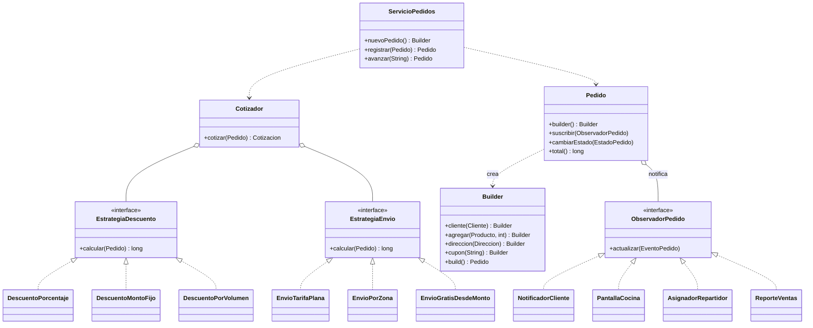

# Pedidos a domicilio con patrones de diseño

Aplicación de consola en Java para gestionar los pedidos de una cocina que vende comida a domicilio.
Es el proyecto de aplicación de la asignatura Patrones de Desarrollo de Software
(Especialización en Desarrollo de Software).

## Problema

Una cocina recibe pedidos por teléfono y por mensajes. Cada pedido tiene muchos datos, algunos
obligatorios y otros opcionales: productos, dirección, forma de pago, notas y cupón. Los descuentos
y el costo de envío cambian con frecuencia por promociones, y cada vez que un pedido avanza hay que
avisar a la cocina, al repartidor y al cliente. Si todo eso vive en una sola clase, cada cambio
comercial obliga a modificar código que ya funciona.

## Patrones aplicados

| Patrón | Dónde está | Qué resuelve |
|--------|-----------|--------------|
| Builder | `dominio/Pedido.java` (clase interna `Builder`) | Crea pedidos con muchos datos opcionales y valida todo en `build()`, de modo que nunca existe un pedido incompleto. |
| Observer | `dominio/ObservadorPedido.java`, `dominio/Pedido.java`, paquete `observadores` | El pedido avisa a quien lo observa cada vez que cambia de estado, sin conocer las clases concretas. |
| Strategy | paquete `estrategias` | Los descuentos y el costo de envío son algoritmos intercambiables que el `Cotizador` usa sin saber cuál es. |

## Estructura

```
src/main/java/co/edu/pedidos/
├── App.java                    demostración por consola
├── dominio/                    Producto, Cliente, Pedido (Builder + sujeto del Observer), estados
├── observadores/               NotificadorCliente, PantallaCocina, AsignadorRepartidor, ReporteVentas
├── estrategias/                descuentos, envíos y Cotizador (contexto de Strategy)
└── servicio/                   ServicioPedidos: integra los tres patrones
src/test/java/...               pruebas con JUnit 5
```

## Diagrama de clases



## Requisitos

- JDK 17 o superior
- Maven 3.8 o superior

## Cómo ejecutarlo

1. Descargar el proyecto:

   ```bash
   git clone https://github.com/Maxtro2002/pedidos-domicilio-patrones.git
   cd pedidos-domicilio-patrones
   ```

2. Ejecutar las pruebas:

   ```bash
   mvn test
   ```

3. Ejecutar la demostración:

   ```bash
   mvn compile exec:java
   ```

   La demostración registra dos pedidos, rechaza un cupón que no aplica y recorre los estados de
   cada pedido mientras se muestran los avisos a la cocina, al repartidor y al cliente.

En Windows, si las tildes se ven mal en la consola, ejecutar antes `chcp 65001`.

Sin Maven, solo con el JDK:

```bash
javac -d out $(find src/main -name "*.java")
java -cp out co.edu.pedidos.App
```

## Cómo extenderlo

- **Un descuento nuevo**: crear una clase que implemente `EstrategiaDescuento` y registrarla como
  cupón con `ServicioPedidos.registrarCupon(...)`. No hay que modificar ninguna clase existente.
- **Un aviso nuevo** (por ejemplo, un correo al administrador cuando se cancela un pedido): crear una
  clase que implemente `ObservadorPedido` y pasarla al constructor de `ServicioPedidos`.
- **Un dato nuevo del pedido**: agregar el campo y su método en `Pedido.Builder`. El código que ya
  crea pedidos sigue funcionando.

## Autor

José Santiago Pelaez Ramirez. Docente: Ricardo Augusto.
